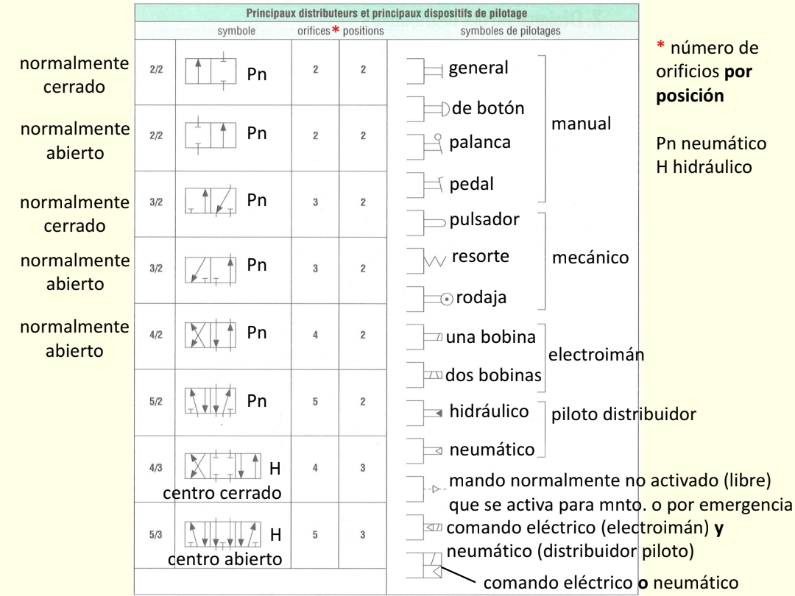
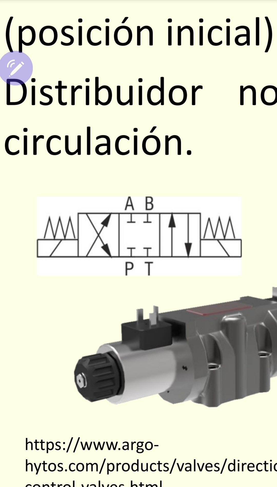
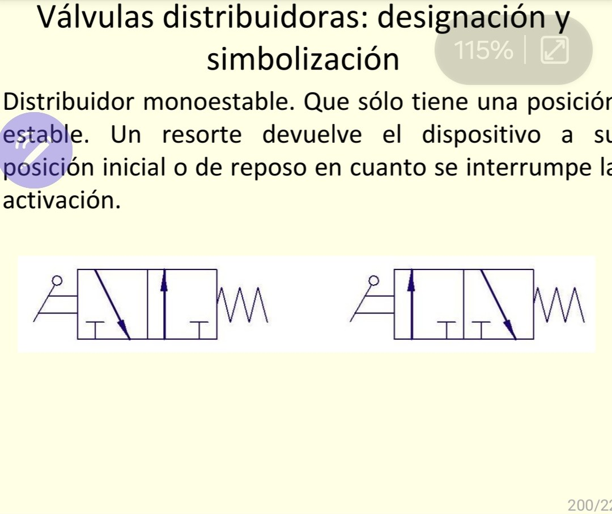
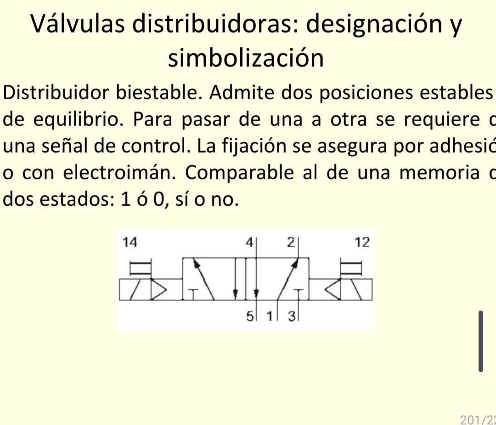

# Válvulas distribuidoras: animaciones de neumática e hidráulica

## 1. Qué es este proyecto y cómo se usa

Es una página web educativa, de un solo archivo (`index.html`), que muestra cómo funcionan doce válvulas distribuidoras. Cada una tiene un corte longitudinal animado y su símbolo normalizado conectado a un circuito, junto a la imagen del curso en la que se basa. No necesita internet ni instalar nada.

Las primeras ocho siguen la tabla de referencia del curso, en el mismo orden:

1. 2/2 normalmente cerrada (neumática, Pn), con botón y resorte, alimentando un motor neumático.
2. 2/2 normalmente abierta (Pn), con botón y resorte, alimentando un motor neumático.
3. 3/2 normalmente cerrada (Pn), con palanca y resorte, sobre un cilindro de simple efecto.
4. 3/2 normalmente abierta (Pn), con palanca y resorte, sobre un cilindro de simple efecto.
5. 4/2 monoestable (Pn), con una bobina y resorte, sobre un cilindro de doble efecto.
6. 5/2 biestable (Pn), con pilotaje 14 y 12, sobre un cilindro de doble efecto.
7. 4/3 centro cerrado (hidráulica, H), con solenoides Y1 y Y2 y centrado por resortes.
8. 5/3 centro abierto (H), con solenoides Y1 y Y2 y centrado por resortes.

Las otras cuatro, en el grupo **Diapositivas del curso** del menú, reproducen el símbolo exactamente como lo dibuja cada diapositiva:

9. 4/3 centro cerrado de solenoides (H), con el resorte dibujado encima de cada bobina.
10. 3/2 monoestable con palanca, símbolo izquierdo de la diapositiva (normalmente abierta).
11. 3/2 monoestable con palanca, símbolo derecho de la diapositiva (normalmente cerrada).
12. 5/2 biestable con mando 14 / 12.

Algunas válvulas aparecen dos veces, una en la tabla y otra en una diapositiva. Físicamente son la misma válvula; lo que cambia es cómo se dibuja el símbolo (el orden de los puertos o de las cajas). Tenerlas por separado permite comparar cada animación con su fuente.

Cómo usar la página:

- Arriba a la derecha hay un menú para elegir la válvula. También puedes cambiar de válvula editando el final de la dirección (por ejemplo `#5-3-centro-abierto`).
- Junto al menú está **Velocidad** (0.25× a 2×), que hace más lenta o más rápida toda la animación: corredera, cilindro, motor y flujo. El navegador recuerda la última velocidad elegida.
- Los botones **Corte**, **Símbolo** y **Ambos** deciden qué se ve. El corte muestra la corredera por dentro; el símbolo muestra la representación normalizada con el cilindro o el motor.
- Debajo hay botones de mando. En las válvulas de botón, palanca o una bobina, mantén presionado el botón: la válvula cambia de posición mientras lo sostienes y regresa sola al soltarlo. En la 5/2 hay un pulso para cada lado, y en las de tres posiciones hay tres botones (Energizar Y1, Centro, Energizar Y2).
- Debajo de los botones aparece el texto de la posición actual: qué puertos se conectan y qué hace el actuador.
- El panel de referencia muestra la imagen en la que se basa la válvula: la tabla del profesor para las válvulas 1 a 8 (con su fila resaltada) o la diapositiva correspondiente para las 9 a 12 (con su símbolo resaltado). Puedes acercar con los botones + y −, con la rueda del ratón (acerca hacia donde está el cursor) o pellizcando en pantallas táctiles. Arrastra para moverte. Doble clic o doble toque alterna el zoom. **Restablecer** muestra la imagen completa e **Ir a esta fila** (o **Ir al símbolo** en las diapositivas) acerca a la parte que corresponde a la válvula que estás viendo. En el celular el panel queda debajo de la animación y se puede plegar.

## 2. Imágenes de referencia

Cada válvula de la página muestra a la derecha (o abajo en el celular) la imagen en la que se basa, con su símbolo o su fila resaltada. Estas son las imágenes y lo que se tomó de cada una:

### Tabla "Principaux distributeurs et principaux dispositifs de pilotage"

Archivo: `assets/tabla-distribuidores.jpg`. Base de las válvulas 1 a 8. De ella salen el número de vías y posiciones, el dibujo de cada caja, el medio de trabajo (Pn neumático, H hidráulico) y los símbolos de pilotaje.



### Diapositiva "Distribuidor no circulación (posición inicial)"

Archivo: `assets/diapo-4-3-solenoide.jpg`. Base de la válvula 9. Muestra el símbolo de la 4/3 de centro cerrado con solenoides y resortes de centrado y una foto de una válvula comercial de ese tipo (fabricante Argo-Hytos, enlace en la propia diapositiva).



### Diapositiva "Distribuidor monoestable"

Archivo: `assets/diapo-3-2-monoestable.jpg`. Base de las válvulas 10 y 11. Define al distribuidor monoestable (una sola posición estable, el resorte lo regresa al reposo) y dibuja dos 3/2 con palanca y resorte. El símbolo izquierdo tiene la flecha de paso en la caja de reposo, por eso es normalmente abierto; el derecho tiene la alimentación bloqueada en reposo, por eso es normalmente cerrado.



### Diapositiva "Distribuidor biestable"

Archivo: `assets/diapo-5-2-biestable.jpg`. Base de la válvula 12 y referencia para la 5/2 de la tabla. Define al distribuidor biestable (dos posiciones estables, comparable a una memoria de dos estados) y dibuja una 5/2 con mando 14 y 12 y numeración ISO 5599.



## 3. Estructura de archivos

```
valvulas-distribuidoras/
├── index.html                       La página completa (diseño, animaciones y datos)
├── README.md                        Este archivo
└── assets/
    ├── tabla-distribuidores.jpg     Tabla de referencia (válvulas 1 a 8)
    ├── diapo-4-3-solenoide.jpg      Diapositiva de la 4/3 de solenoides (válvula 9)
    ├── diapo-3-2-monoestable.jpg    Diapositiva del distribuidor monoestable (válvulas 10 y 11)
    └── diapo-5-2-biestable.jpg      Diapositiva del distribuidor biestable (válvula 12)
```

La carpeta `assets` debe quedar junto a `index.html` y con ese nombre exacto, porque la página busca ahí las cuatro imágenes.

## 4. Crear la cuenta de GitHub y el repositorio

GitHub es un sitio donde se guardan proyectos y, además, se pueden publicar páginas web gratis. Un repositorio es la carpeta de tu proyecto dentro de GitHub.

1. Entra a https://github.com. Si ya tienes cuenta, inicia sesión y pasa al paso 4. Si no, pulsa **Sign up**, escribe tu correo, una contraseña y un nombre de usuario, y confirma el código que te llegue por correo. Tu nombre de usuario formará parte del enlace público de la página, así que elige uno que no te incomode compartir.
2. Una vez dentro, arriba a la derecha pulsa el botón **+** y elige **New repository**. También puedes pulsar el botón verde **New** en la página principal.
3. Llena el formulario así:
   - **Owner**: déjalo con tu usuario.
   - **Repository name**: escribe `valvulas-distribuidoras` (sin espacios ni acentos).
   - **Description** (opcional): `Animaciones de válvulas distribuidoras neumáticas e hidráulicas con corte y símbolo`.
   - **Public**: márcalo. Para publicar la página gratis con GitHub Pages el repositorio debe ser público.
   - **Add a README file**: NO lo marques, porque ya tenemos un `README.md` y se duplicaría.
   - **Add .gitignore**: deja `No .gitignore`.
   - **Choose a license**: es opcional. Puedes dejar `None` o elegir `MIT License` si quieres que otras personas puedan reutilizar el código.
4. Pulsa el botón verde **Create repository**. Llegarás a una página casi vacía con instrucciones; no necesitas seguirlas.

## 5. Subir los archivos desde el navegador

1. En la página del repositorio recién creado, busca el texto **uploading an existing file** (aparece en la sección de configuración rápida) y pulsa ese enlace. Si no lo ves, pulsa el botón **Add file** y luego **Upload files**.
2. Abre en tu computadora la carpeta donde guardaste el proyecto. Selecciona `index.html`, `README.md` y la carpeta `assets` completa, y arrástralos a la zona que dice **Drag files here**. La carpeta `assets` debe conservarse como carpeta, con la imagen adentro.
3. Si tu navegador no te deja arrastrar carpetas, sube primero `index.html` y `README.md`. Luego pulsa **Add file > Create new file**, escribe en el nombre `assets/LEEME.txt` (al teclear la diagonal GitHub crea la carpeta `assets`), pon cualquier texto y pulsa **Commit changes**. Después entra a la carpeta `assets` en GitHub, pulsa **Add file > Upload files** y arrastra ahí las cuatro imágenes (`tabla-distribuidores.jpg` y las tres `diapo-...jpg`). Lo importante es que todas terminen dentro de `assets/`.
4. Espera a que cada archivo muestre su barra de carga completa. Abajo, en el cuadro **Commit changes**, escribe un mensaje, por ejemplo `Agrego animaciones de válvulas y tabla de referencia`.
5. Deja marcada la opción **Commit directly to the main branch** y pulsa el botón verde **Commit changes**.
6. Comprueba que en la página del repositorio se vean `index.html`, `README.md` y la carpeta `assets`. Entra a `assets` para confirmar que está la imagen.

## 6. Publicar con GitHub Pages

1. En la página del repositorio pulsa la pestaña **Settings** (Configuración), arriba a la derecha de las pestañas.
2. En el menú de la izquierda pulsa **Pages**.
3. En la sección **Build and deployment**, en **Source**, elige **Deploy from a branch**.
4. En **Branch**, elige `main` en el primer menú y `/ (root)` en el segundo. Pulsa **Save**.
5. Espera de 1 a 3 minutos. Recarga la página de **Pages** de vez en cuando. Cuando esté listo, arriba aparece un mensaje que dice **Your site is live at** seguido del enlace.
6. El enlace tiene este formato, cambiando USUARIO por tu nombre de usuario de GitHub: `https://USUARIO.github.io/valvulas-distribuidoras/`
7. Para ver el avance, entra a la pestaña **Actions** del repositorio. Ahí aparece un proceso llamado **pages build and deployment**. Si tiene un círculo amarillo, sigue trabajando; con una palomita verde, ya terminó; con una cruz roja, hubo un problema (revisa la sección 9).

## 7. Verlo sin internet

1. Descarga los archivos: en la página del repositorio pulsa el botón verde **Code** y luego **Download ZIP**.
2. Descomprime el ZIP en una carpeta.
3. Abre `index.html` con doble clic. Se abrirá en tu navegador y funciona sin conexión, siempre que la carpeta `assets` siga junto a `index.html`.

## 8. Compartirlo con el profesor y actualizarlo

- Para compartirlo, envía el enlace de la página (`https://USUARIO.github.io/valvulas-distribuidoras/`). Si además quieres que vea el código, envía el enlace del repositorio (`https://github.com/USUARIO/valvulas-distribuidoras`).
- Para actualizar un archivo, entra al repositorio, pulsa **Add file > Upload files** y sube de nuevo el archivo con exactamente el mismo nombre (y dentro de la misma carpeta si es la imagen). GitHub lo reemplaza. Escribe un mensaje de commit y pulsa **Commit changes**. La página se vuelve a publicar sola en uno o dos minutos.

## 9. Problemas comunes

- **Aparece un 404 justo después de publicar.** Es normal los primeros minutos. Espera 3 minutos, revisa que la pestaña **Actions** muestre la palomita verde y recarga. Confirma también que `index.html` esté en la raíz del repositorio y no dentro de otra carpeta, y que en Pages esté elegida la rama `main` con `/ (root)`.
- **Una imagen de referencia no carga.** El panel mostrará un aviso con el nombre del archivo que falta. Revisa que la carpeta se llame `assets` y que los archivos conserven sus nombres exactos (`tabla-distribuidores.jpg`, `diapo-4-3-solenoide.jpg`, `diapo-3-2-monoestable.jpg`, `diapo-5-2-biestable.jpg`), todo en minúsculas y sin espacios. GitHub distingue mayúsculas de minúsculas: `Assets` o `Tabla-Distribuidores.JPG` no funcionarán. Revisa también que la carpeta `assets` esté al mismo nivel que `index.html`.
- **Subí un cambio pero no lo veo.** El navegador guarda copias. Recarga forzando con Ctrl + F5 (en Mac, Cmd + Shift + R), o abre la página en una ventana de incógnito. En el celular, cierra la pestaña y vuelve a abrir el enlace.
- **El repositorio no me deja activar Pages.** Verifica que sea público (**Settings > General**, al final, en **Danger Zone**, aparece su visibilidad).

## 10. Créditos

La tabla y las tres diapositivas de referencia fueron tomadas del material del curso de Hidráulica. Las animaciones se hicieron con ayuda de Claude.
